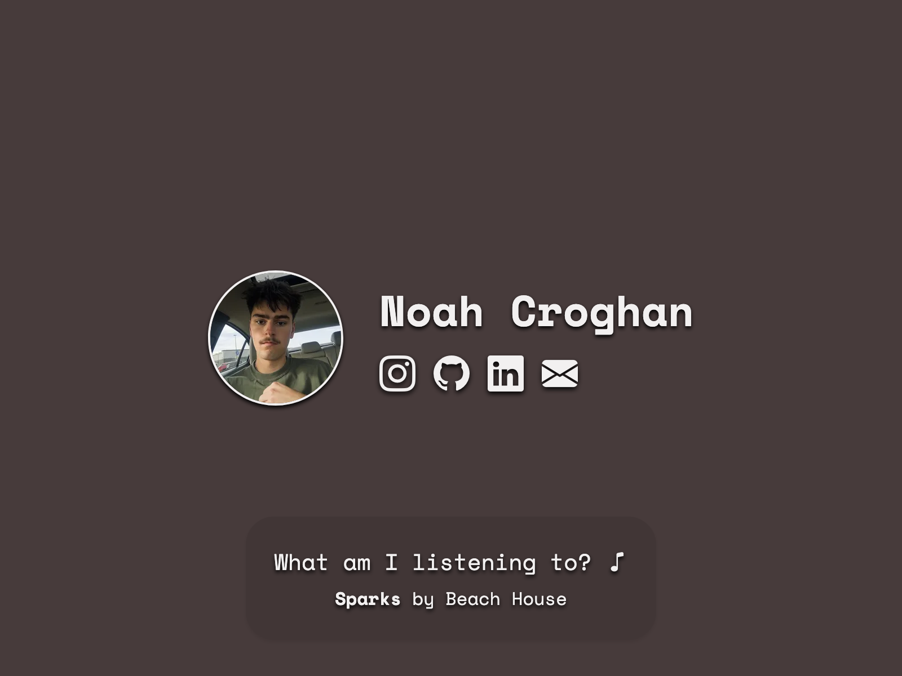

# Personal Website

This repository contains the code for my personal link-in-bio site,
featuring social links and a real-time Spotify "now playing" widget.

## Preview



## Local Development

1. Clone and enter the project:

   ```bash
   git clone https://github.com/noahcroghan/personal-website.git
   cd personal-website
   ```

2. Install [dependencies](https://bun.sh):

   ```bash
   bun install
   ```

3. Set up Spotify:
   1. Create an app in the [Spotify Developer Dashboard](https://developer.spotify.com/dashboard) with the Web API enabled and `http://127.0.0.1:8888/callback` as a redirect URI. Development Mode apps require the owner to have Spotify Premium.
   2. Copy `.env.example` to `.env` and fill in the app's client ID and secret.
   3. Authorize the site to read your playback, which saves a refresh token to `.env`:

      ```bash
      bun run spotify:auth
      ```

4. Start the dev server:

   ```bash
   bun run dev
   ```

## Building

To build the website, run the following:

```bash
bun run build
```

This will go through the process of building the website with [Vite](https://vite.dev). It also copies `functions/` into `dist/`, which Cloudflare Pages compiles into a Function on deploy.

The site is written in [TypeScript](https://www.typescriptlang.org). Vite strips types during the build without checking them, and Cloudflare Pages compiles the Function in `functions/` on deploy, so run the type checker separately:

```bash
bun run typecheck
```

Lint the code with [ESLint](https://eslint.org) and the Markdown with [markdownlint](https://github.com/DavidAnson/markdownlint-cli2):

```bash
bun run lint
```

## Deploying

- This website is deployed using [Cloudflare Pages](https://pages.cloudflare.com)
  - Set `SPOTIFY_CLIENT_ID`, `SPOTIFY_CLIENT_SECRET`, and `SPOTIFY_REFRESH_TOKEN` as Pages Function secrets in the project's dashboard settings, so `functions/now-playing.ts` can read them server-side at request time. These are never exposed to the client.
- Set the framework to none and follow Vite's [build instructions](https://vite.dev/guide/static-deploy.html)

### Renewing Spotify Authorization

Spotify [expires refresh tokens six months after authorization](https://developer.spotify.com/documentation/web-api/tutorials/refreshing-tokens), and refreshing an access token doesn't extend that. Before then, rerun `bun run spotify:auth`, copy the new `SPOTIFY_REFRESH_TOKEN` from `.env` into the Pages secrets, and redeploy.

The script also records the date in `.github/spotify-authorized-at`; commit it. A [scheduled workflow](./.github/workflows/spotify-reauth-reminder.yml) opens an issue a month before the token expires, and closes it once a newer date is pushed.

## Credits

- Icons are courtesy of [Bootstrap Icons](https://icons.getbootstrap.com/)
- Font used is [Space Mono](https://fonts.google.com/specimen/Space+Mono)
  - Font License: [SIL Open Font License, Version 1.1](https://openfontlicense.org/open-font-license-official-text)

## License

The source code is licensed under [MIT](./LICENSE).

Personal content, such as my likeness (`docs/preview.png`, `public/headshot.jpg`), is all rights reserved.
